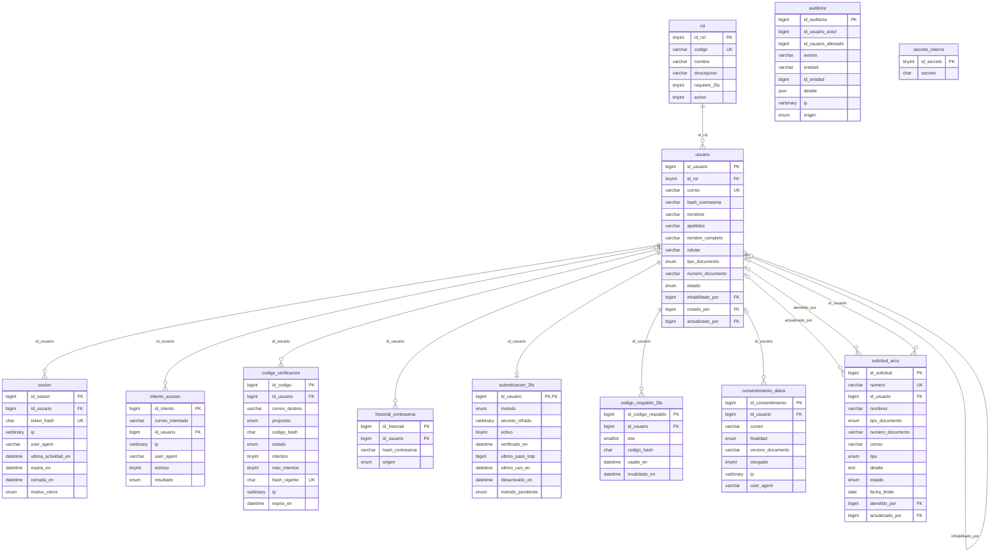
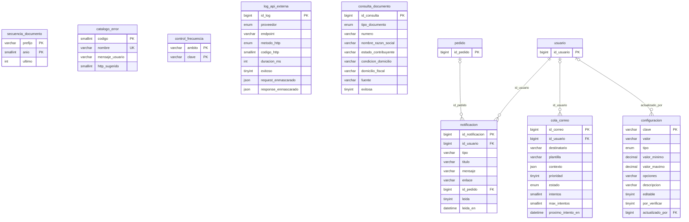
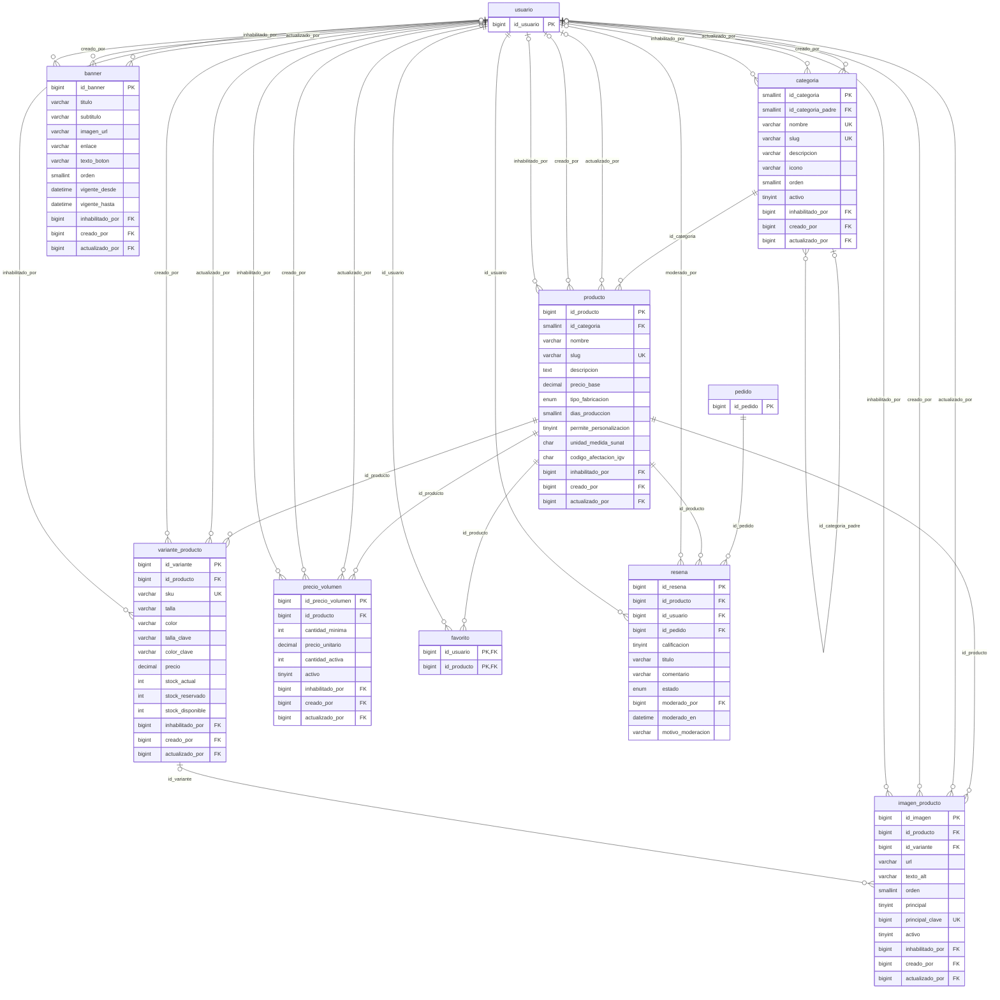
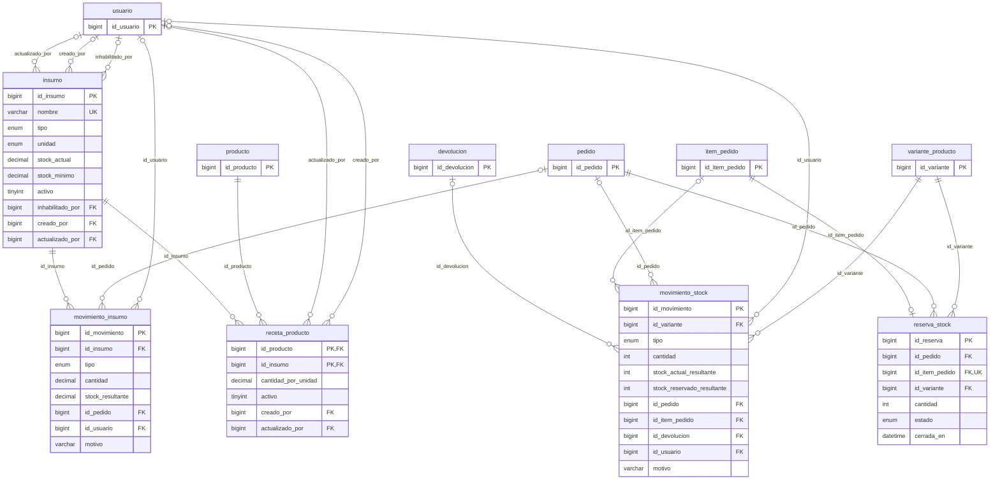
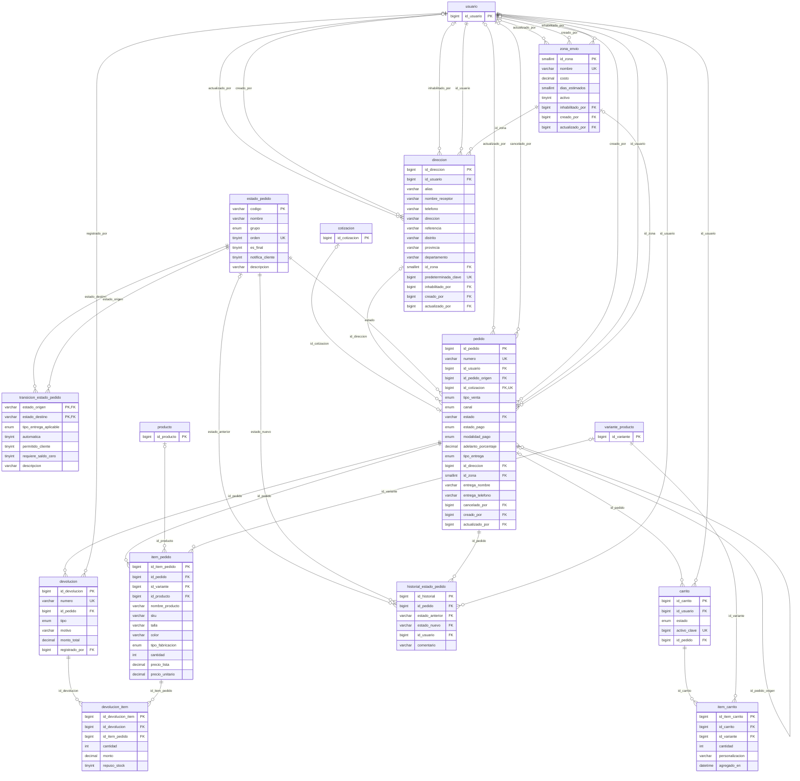
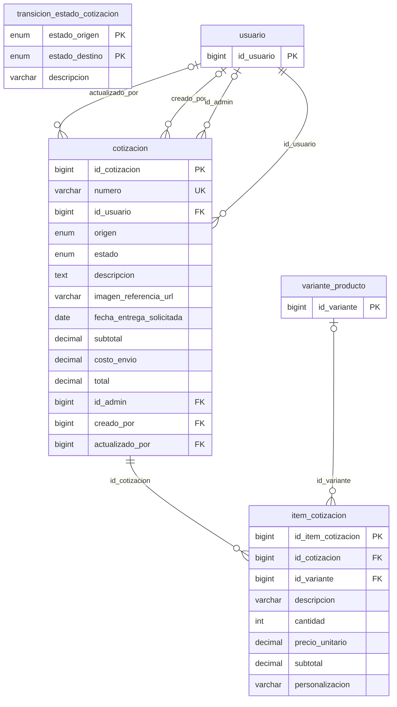
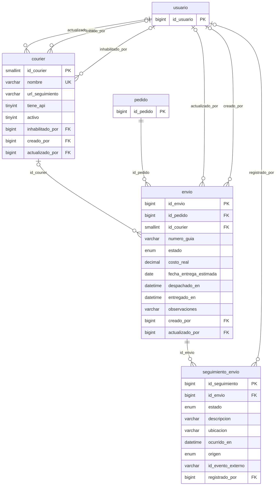
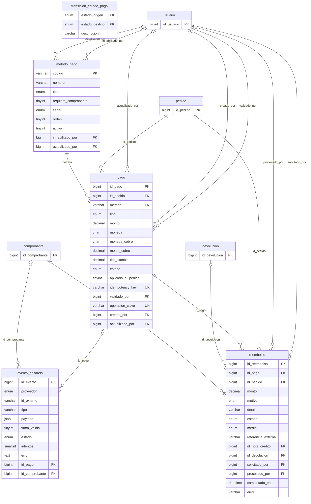
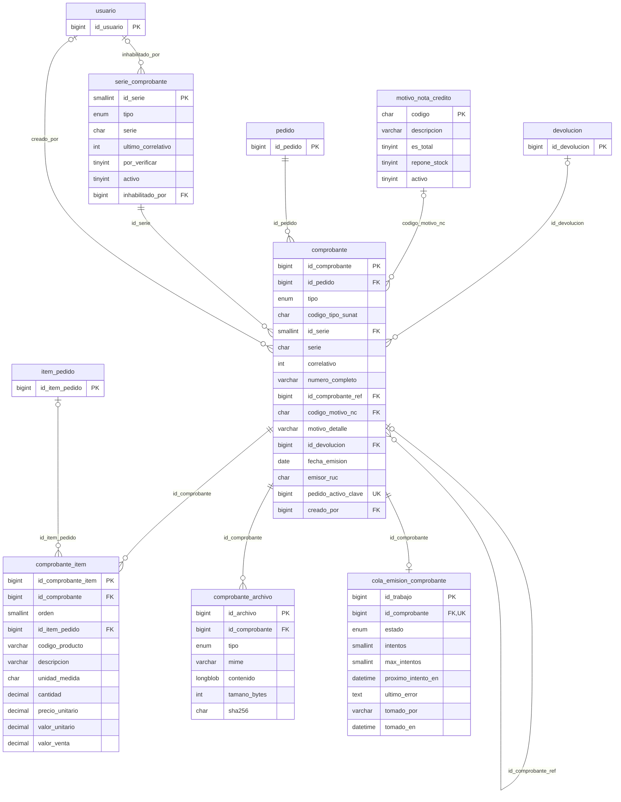
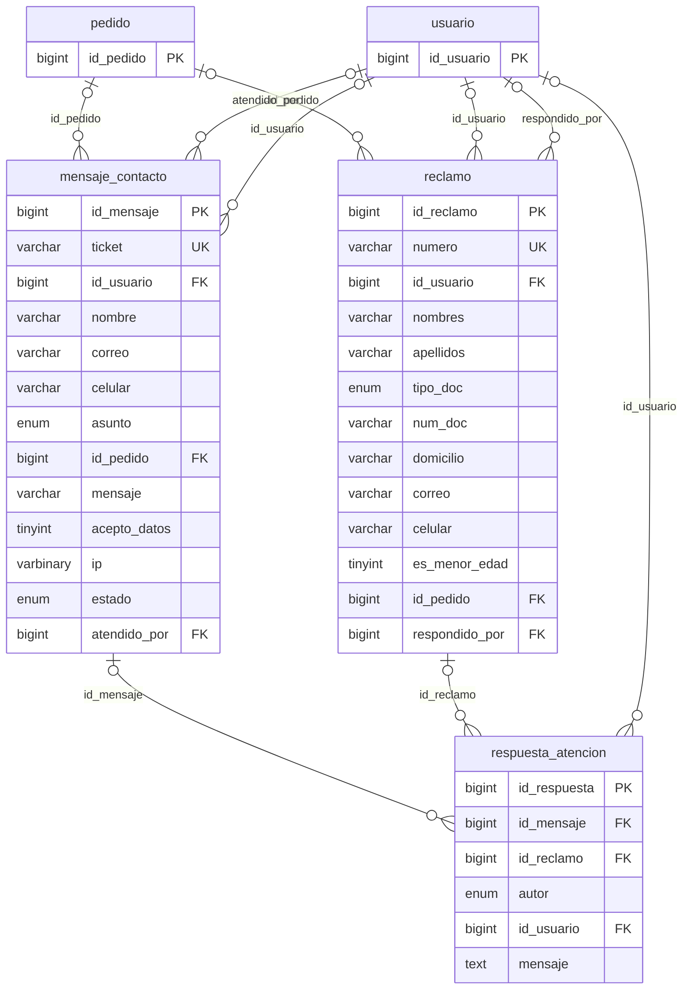

# Diagrama entidad-relación — Bordados Wanka S.A.C.

> Generado desde `information_schema` (`scripts/generar_documentacion.py`). Un diagrama por módulo para que sea legible; las tablas de otros módulos aparecen solo con su llave primaria. Se muestran llaves y columnas principales (las de auditoría `creado_*`, `actualizado_*`, `inhabilitado_*` se omiten). Notación Mermaid `erDiagram` (GitHub, VS Code y GitLab lo dibujan).

## Acceso y seguridad

## Sistema e integraciones

## Catálogo

## Inventario e insumos

## Compra y pedidos

## Cotizaciones

## Envíos

## Pagos y reembolsos

## Comprobantes electrónicos

## Atención al cliente

